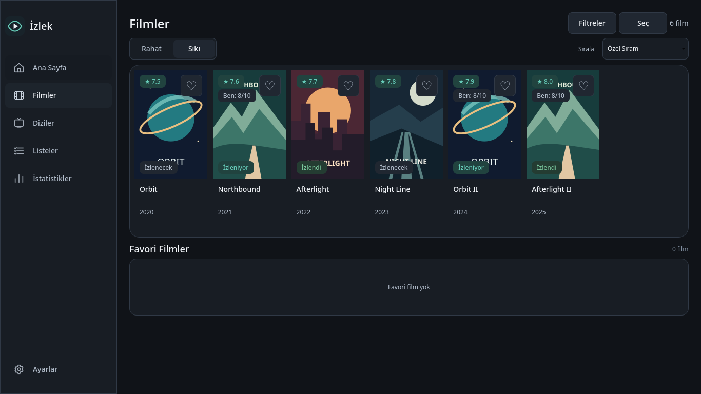
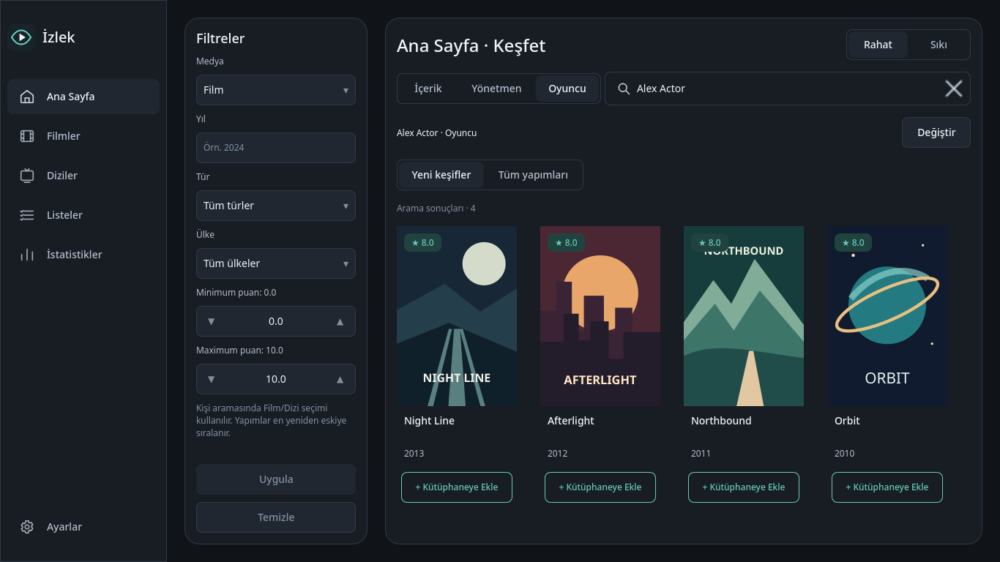
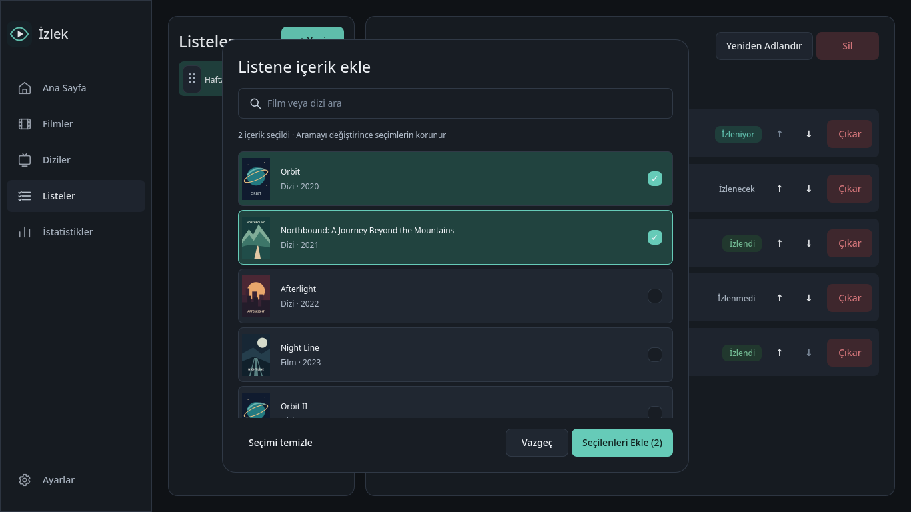
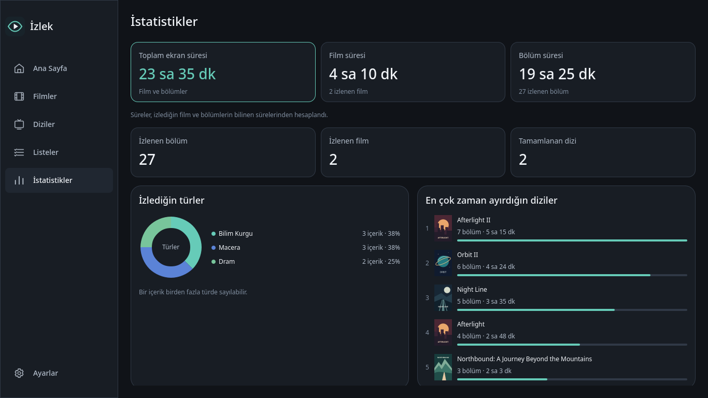
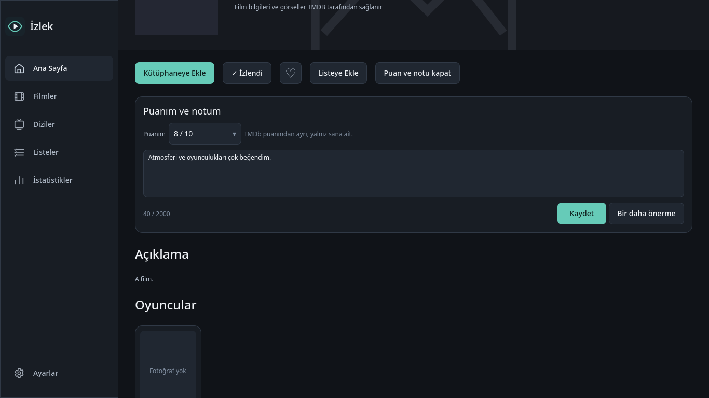
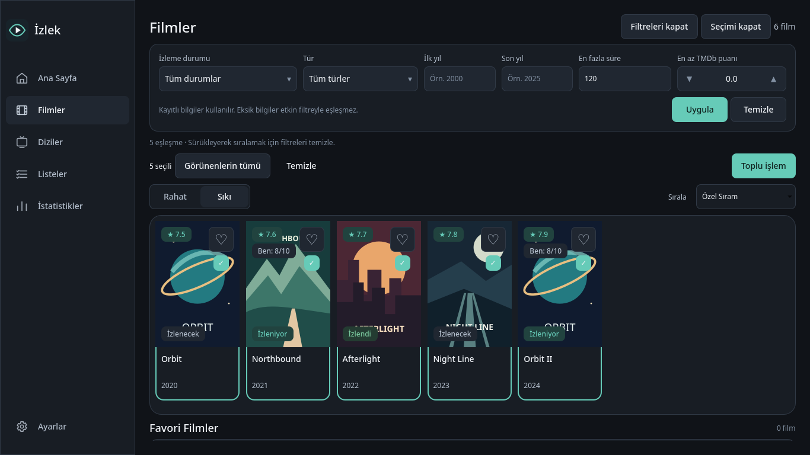

<div align="center">


# İzlek

**Filmlerini, dizilerini ve kaldığın bölümü tek yerde takip et.**

Linux öncelikli, Windows için EXE paketleme desteği olan Türkçe bir masaüstü uygulaması.<br>
Kütüphanen, listelerin ve izleme geçmişin cihazında kalır.

[](https://github.com/Teknoloji-Filozoflari/Izlek/actions/workflows/ci.yml)
[](pyproject.toml)
[](#kurulum-ve-indirme)
[](LICENSE)

[Özellikler](#özellikler) · [Ekran görüntüleri](#ekran-görüntüleri) · [İndir](#kurulum-ve-indirme) · [Belgeler](#belgeler) · [Katkı](#katkı)

</div>



## Özellikler

| | İzlek ile |
| --- | --- |
| **Kütüphanen** | Film ve dizilerini İzlenecek, İzleniyor ve İzlendi durumlarıyla düzenle; favorilerini seç. |
| **Kaldığın bölüm** | Bölümleri tek tek işaretle, sezon ilerlemesini gör ve Diziler sekmesindeki Devam Et kartlarından devam et. |
| **Keşfet ve ara** | Popüler içerikleri tür, yıl, ülke ve puanla filtrele; içerik, yönetmen veya oyuncu adına göre ara. |
| **Oyuncu ve yönetmen yapımları** | Seçtiğin kişinin film/dizilerini gör; Yeni keşifler veya izleme rozetleriyle Tüm yapımları arasında geçiş yap. |
| **İçerik detayları** | Oyuncuya tıklayarak yapımlarına git; fragmanları, önerileri ve Türkiye’deki izleme sağlayıcılarını incele. |
| **Özel listeler** | Afişli seçiciden birden fazla içerik ekle; listende izleme durumlarını gör, listeleri ve üyelerini sırala. |
| **Sana ait sıralama** | Film/dizi afişini veya başlığını tutup sürükle; kaydedilen düzenine Özel Sıram ile dön. |
| **Kişisel puan ve not** | Listeye Ekle yanındaki Puan ve not düğmesini aç; 1–10 puan ve 2000 karaktere kadar not kaydet. |
| **Filtre ve toplu işlem** | Kütüphaneyi tür/yıl/süre/durum/puanla süz; kart seçip durum, favori veya liste işlemi uygula. |
| **Öneri tercihleri** | İlgini çekmeyen yapımları Bir daha önerme ile gizle, Ayarlar'dan geri aç. |
| **Görünüm** | Keşfet, Filmler ve Diziler'de Rahat/Sıkı kart düzenini seç; TMDb ve kişisel puanlarını ayrı gör. |
| **İstatistikler** | Toplam, film ve bölüm sürelerini ayrı kartlarda; tür dağılımını ve en çok izlediğin dizileri grafiklerde gör. |
| **Çevrimdışı kullanım** | Kayıtlı kütüphane bilgilerine eriş; kütüphane afişleri ve arka planları yerelde korunsun. |
| **Veri aktarımı** | Kütüphaneni, ilerlemeni, özel sıralarını, puan/not ve öneri tercihlerini JSON olarak dışa aktar, başka kurulumda içe al. |

Normal içerik araması kayıtlı ve izlenmiş yapımları gizler; film/dizi
önerilerinde İzlendi durumundakiler gösterilmez. Oyuncu veya yönetmen
aramasında **Tüm yapımları** seçerek kayıtlı içerikleri de görebilirsin.
Önerilen bir içeriğe girdikten sonra Geri ile önceki film/diziye dönersin.
`Ctrl+K` aramayı açar. Ayrıntılı kullanım [kullanım rehberinde](docs/user-guide.md).

Hesap oluşturma, reklam veya analytics yok. İçerik araması ve yeni bilgiler için
internet ve kendi **TMDB API Read Access Token**’ın gerekir.

## Ekran görüntüleri

Görseller güncel kaynak koddan, geçici bir demo kütüphaneyle **1366 × 768**
boyutunda alındı. Başlıklar ve afişler projedeki örnek içeriklerdir;
gerçek kullanıcı verisi içermez. Görsellere tıklayarak tam boyutta açabilirsin.

<table>
  <tr>
    <td width="50%"><strong>Ana Sayfa · Keşfet</strong><br>Oyuncu/yönetmen araması ve yeni keşifler.<br><a href="docs/screenshots/actor-new-1366.png"></a></td>
    <td width="50%"><strong>Film kütüphanesi</strong><br>Özel sıra, izleme durumu ve kişisel puanlar.<br><a href="docs/screenshots/card-direct-1366.png"></a></td>
  </tr>
  <tr>
    <td width="50%"><strong>Özel listeler</strong><br>Afişli arama ve çoklu içerik ekleme.<br><a href="docs/screenshots/multi-picker-1366.png"></a></td>
    <td width="50%"><strong>İstatistikler</strong><br>Süre kartları ve açıklayıcı grafikler.<br><a href="docs/screenshots/design-statistics-1366.png"></a></td>
  </tr>
  <tr>
    <td width="50%"><strong>Puan ve not</strong><br>İşlem satırındaki düğmeyle açılan kişisel form.<br><a href="docs/screenshots/review-actions-movie-open-1366.png"></a></td>
    <td width="50%"><strong>Filtre ve toplu işlem</strong><br>Kütüphaneni süz ve kartları birlikte düzenle.<br><a href="docs/screenshots/personal-library-1366.png"></a></td>
  </tr>
</table>

## Kurulum ve indirme

Yukarıdaki özellikler ve görseller güncel **kaynak kodu** anlatır.
Linux indirmeleri **v1.0.1** paketleridir; bu geliştirmeler için yeni
kurulum paketleri henüz yayımlanmadı. Yeni özellikleri denemek için
[kaynak koddan çalıştırma](#kaynak-koddan-çalıştır) adımlarını kullan.

**[Linux v1.0.1 paketleri](https://github.com/Teknoloji-Filozoflari/Izlek/releases/tag/v1.0.1)** ·
**[Windows EXE üretimi ve indirme](https://github.com/Teknoloji-Filozoflari/Izlek/actions/workflows/windows.yml)**

Windows 10/11 x64 için **Windows EXE** işleminin başarılı koşusundaki
**Artifacts → izlek-windows-x64** arşivini indirip aç; içindeki
`Izlek-<sürüm>-windows-x64-setup.exe` dosyasını çalıştır. Bu ilk Windows
paketleme akışıdır; bu geliştirme oturumunda gerçek Windows build'i
doğrulanmadı. Başarısız veya devam eden koşuda indirme dosyası oluşmaz.
Yeni sürüm etiketiyle yayımlamada EXE, kontrolleri geçtikten sonra release'e
de eklenir. Ayrıntılar: [Windows paketleme rehberi](packaging/windows/README.md).

İndirdiğin biçimin kurulum komutunu aşağıdan seçebilirsin.

| Biçim | Hedef | Kurulum |
| --- | --- | --- |
| **Windows EXE** | Windows 10/11 x64 | Yukarıdaki başarılı Windows EXE koşusundan kurulum dosyasını indir ve çalıştır. |
| **AppImage** | x86_64 Linux, glibc 2.35+ | `chmod +x Izlek-1.0.1-x86_64.AppImage`, ardından dosyayı çalıştır. |
| **DEB** | Ubuntu 22.04 / 24.04 amd64 | `sudo apt install ./izlek_1.0.1_amd64.deb` |
| **RPM** | Fedora 43 x86_64 | `sudo dnf install ./izlek-1.0.1-1.fc43.x86_64.rpm` |
| **Snap** | snapd bulunan amd64 Linux | `sudo snap install --dangerous ./izlek_1.0.1_amd64.snap` |
| **Nix / NixOS** | x86_64 Linux | `nix run github:Teknoloji-Filozoflari/Izlek/v1.0.1` |
| **Wheel / kaynak** | Python 3.11+ Linux | Release dosyaları; Python ve Qt sistem bağımlılıkları gerekir. |
| **Arch / AUR** | Arch Linux | [PKGBUILD rehberi](packaging/arch/README.md); AUR yayını yapılmadı. |

AppImage, DEB, RPM ve Snap kurulum/açılış kontrollerinden geçti; ayrıca
sanal X11 masaüstünde pencere açmaları doğrulandı. Nix için build, 226 test
ve kurulu paketin offscreen açılışı doğrulandı. ARM64 ve gerçek NixOS
masaüstü doğrulaması henüz yok. Diğer Debian/RPM dağıtımları ayrıca
test edilmelidir.

Snap dosyası GitHub'dan kurulur; Snap Store yayını yoktur.
Anahtarlık erişimi için `sudo snap connect izlek:password-manager-service`
çalıştırılabilir. Snap kütüphanesi sistem kurulumundan ayrı tutulur.

AppImage için FUSE yoksa `APPIMAGE_EXTRACT_AND_RUN=1 ./Izlek-1.0.1-x86_64.AppImage`
kullan. Ubuntu'da Qt sistem gereksinimleri gerektiğinde:

```bash
sudo apt install libegl1 libgl1 libfontconfig1 libx11-6 libx11-xcb1 \
  libxcb1 libxkbcommon0 libxkbcommon-x11-0
```

İndirilen dosyalar için release'teki `SHA256SUMS` dosyasını kullanabilirsin.
Ayrıntılar: [AppImage / release](docs/releases.md),
[DEB](packaging/debian/README.md), [RPM](packaging/rpm/README.md),
[Snap](snap/README.md), [Nix](packaging/nix/README.md).

### Kaynak koddan çalıştır

Python **3.11 veya üzeri**, `pip`, sanal ortam desteği ve PySide6’nın
çalışma zamanı kütüphaneleri gerekir.

```bash
git clone https://github.com/Teknoloji-Filozoflari/Izlek.git
cd Izlek
python3 -m venv .venv
source .venv/bin/activate
python -m pip install -e '.[dev]'
python scripts/run_dev.py
```

Windows PowerShell'de sanal ortamı `python -m venv .venv` ile oluştur,
`.venv\Scripts\Activate.ps1` ile aç; kurulum ve başlatma komutları aynıdır.

Bu başlatıcı, kurulu uygulamadan ayrı geliştirme verileri kullanır.
Qt sistem gereksinimleri, sorun giderme ve geliştirici komutları için
[geliştirme rehberine](docs/development.md) bak.

### Kurulu uygulamadan ayrı geliştirme

Bağımlılıklar hazır olduğunda bu klasördeki kaynak kodunu ayrı verilerle aç:

```bash
python scripts/run_dev.py
```

Bu komut yalnız bu projenin `src/` kodunu kullanır. Veritabanı, ayarlar,
önbellek ve loglar proje içindeki Git dışında bırakılan `.dev-data/` altında
tutulur. Sistem anahtarlığı kullanılmaz; geliştirme tokenı verilirse bu
dizinde yalnız kullanıcıya açık dosyaya kaydedilir. Kurulu uygulamanın
kütüphanesi ve tokenı paylaşılmaz. Normal `python -m izlek` komutu ise
varsayılan kullanıcı dizinlerini kullanır.

### İlk açılış

1. TMDB hesabının API ayarlarından **API Read Access Token** al.
2. İzlek’e tokenı gir, **Tokenı Test Et** ve **Kaydet** adımlarını tamamla.
3. Ana Sayfa’dan içerik ara veya keşfet; kütüphanene ekleyip izleme durumunu seç.

Token cihazında saklanır. Sonradan **Ayarlar → TMDb → Tokenı Değiştir**
üzerinden güncelleyebilirsin. İzlek için ayrıca bir hesap gerekmez.

## Verilerin nerede?

| Veri | Varsayılan konum |
| --- | --- |
| Kütüphane, listeler, ilerleme, kişisel puan/not ve sıralar | `~/.local/share/izlek/izlek.sqlite3` |
| Pencere ayarları | `~/.config/izlek/window.ini` |
| İndirilen görseller | `~/.cache/izlek/images` |
| Loglar | `~/.local/state/izlek/logs` |

`XDG_*` değişkenleri tanımlıysa ilgili dizinler kullanılır. Snap’in ayrı
veri yolları [Snap rehberinde](snap/README.md) açıklanır.
Windows'ta ayarlar `%APPDATA%\izlek`, veritabanı `%LOCALAPPDATA%\izlek`,
önbellek ve loglar aynı yerel uygulama klasöründeki `cache` ve `logs`
altındadır. EXE kaldırılırken kişisel veri klasörleri silinmez.

Token öncelikle sistem anahtarlığında saklanır. Anahtarlık kullanılamazsa
`~/.config/izlek/tmdb-token` dosyasına yalnız kullanıcıya açık izinlerle
**düz metin** yazılır ve uygulama bunu bildirir. Token veritabanına, loglara
ve JSON dışa aktarıma girmez.

Kişisel takip verileri cihazında tutulur; bir İzlek sunucusuna gönderilmez.
TMDB arama ve içerik istekleri TMDB’ye gider. Uzak metadata ve kütüphaneye
ait olmayan görseller için 180 günlük temizlik uygulanır; takip durumları,
favoriler, listeler ve bölüm ilerlemesi korunur.

## Belgeler

- [Kullanım rehberi](docs/user-guide.md) — arama, detaylar, listeler ve JSON aktarımı
- [Geliştirme rehberi](docs/development.md) — kurulum, kalite kontrolleri ve masaüstü smoke testleri
- [Mimari](docs/architecture.md) · [QML bileşenleri](docs/components.md)
- [Release süreci](docs/releases.md) · [Değişiklik günlüğü](CHANGELOG.md)

## Katkı

Hata bildirmek veya özellik önermek için [issue açabilirsin](https://github.com/Teknoloji-Filozoflari/Izlek/issues).
Kod katkıları için [CONTRIBUTING.md](CONTRIBUTING.md), güvenlik bildirimleri için
[SECURITY.md](SECURITY.md) dosyasını incele.

```bash
python scripts/quality.py
```

Bu komut Ruff ve tüm pytest testlerini çalıştırır. Testler geçici kullanıcı
verisi ve mock TMDB yanıtları kullanır; gerçek token gerekmez.

## TMDB ve JustWatch

Film, dizi, kişi, puan ve görsel verileri **TMDB** tarafından sağlanır.
Türkiye izleme sağlayıcısı bilgileri TMDB’nin **JustWatch** ortaklığından gelir;
uygulama ilgili ekranlarda kaynak bildirimlerini gösterir.

> This product uses the TMDB API but is not endorsed or certified by TMDB.

Ayrıntılar: [TMDB / JustWatch uyumluluk notu](docs/TMDB_JUSTWATCH_COMPLIANCE.md).

## Lisans

İzlek, [GNU GPL v3 veya sonrası](LICENSE) altında yayımlanır.
Python paket adı `izlek`, GitHub depo adı `Izlek`tir.
